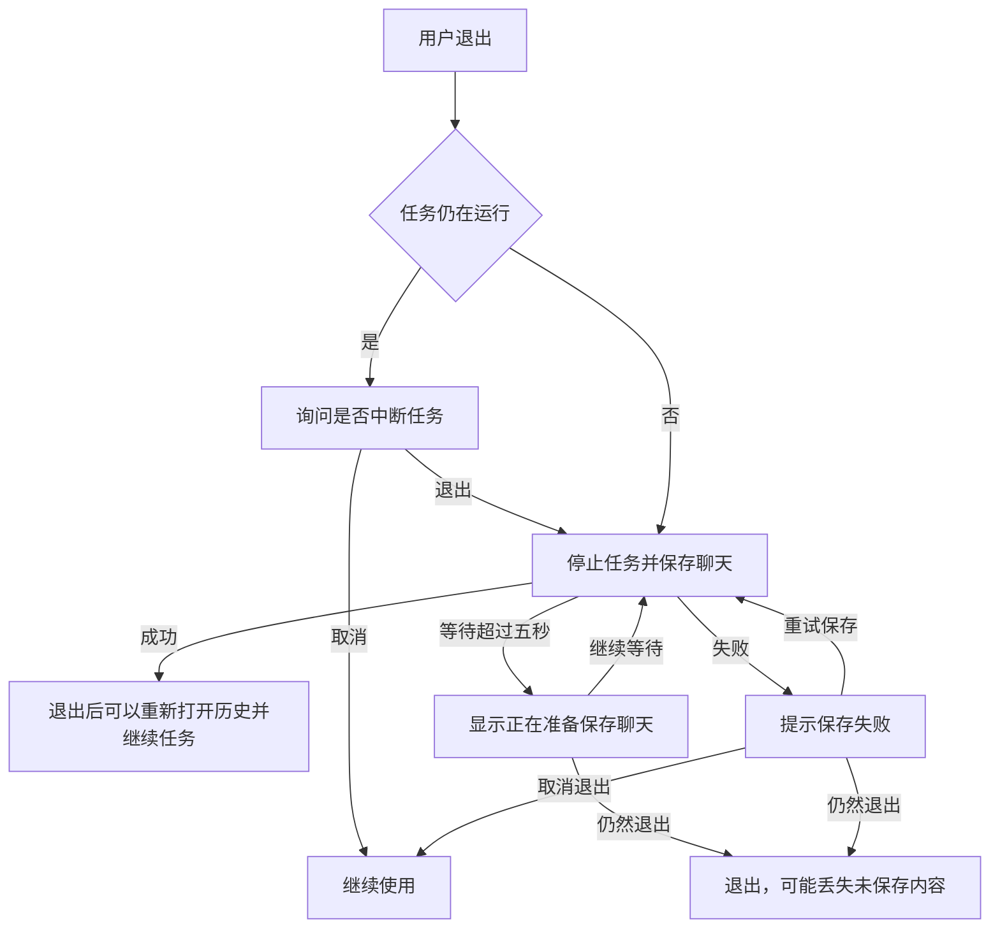

# 退出前保存聊天

## 用户故事

P1：用户停止回复后立即退出，重新启动能够查看已显示内容和停止状态，并继续任务。
Given 回复正在显示，When 点击停止并立即退出，Then 重启后正文和停止状态保持，后续请求包含原有回复。

P1：保存需要等待时，用户知道聊天正在保存，可以继续等待，也可以明确选择仍然退出。保存失败时可以重试保存或者取消退出。
Given 退出前保存超过五秒，When 保存完成，Then 提示自动关闭并退出；When 用户选择继续等待，Then 继续同一次保存；When 用户选择仍然退出，Then 退出并接受提示中说明的未保存内容风险。

## 业务流程

## 概念对照

| 用户说法 | 内部名称 | 界面呈现 |
|---|---|---|
| 停止回复 | abort acknowledgement / terminal | 既有停止状态 |
| 聊天记录 | message ledger / index | 既有侧栏历史 |
| 正在保存聊天 | pending exit preparation | 正在准备保存聊天内容 |
| 继续等待 | preserve pending preparation | 继续等待 |
| 重试保存 | new preparation request | 重试保存 |
| 取消退出 | cancel preparation and release barrier | 取消退出 |
| 仍然退出 | explicit forced exit | 仍然退出 |

## 功能清单

退出等待回复停止和保存完成，正常完成后立即退出也等待保存。运行中确认服务于流程 C，等待提示和两个操作服务于 G，失败提示和三个操作服务于 I。原生提示由主窗口承载，保存成功时自动关闭；窗口保持可见。原生提示关闭按钮在等待期间继续等待，在失败后取消退出。

## 根因与方案

公开客户端的退出没有等待 sidecar 终止确认、消息处理和异步保存。最新 dev 的真实 Electron 重现已显示正文丢失：文件只包含空 assistant 消息，用户消息仍为 running，重启恢复将其标记 failed。

沿用公开 PR #677 的退出参与接口、dispatch barrier 与完整历史 checkpoint，在公开客户端启动时注册通用保存处理。私有 PR #49 的通用保存处理迁入公开客户端，企业专属内容保留私有仓库。

## 执行与验证

- [x] 从最新 origin/dev 创建独立 worktree，初始化真实 Electron 和 Windows native helper。
- [x] 添加立即退出场景，在改动前真实 Electron 重现正文缺失。
- [x] 公开客户端注册通用保存处理，私有模块移除重复注册。
- [x] 验证停止后立即退出、正常退出、重启打开历史与继续任务，以及正常完成的保存。
- [x] 串行执行 verify、build、electron:dev:check、相关 Electron 与 native helper 检查。
- [x] 独立复审。
- [x] 更新关联 Issue 和已有 PR。

R02 聊天归属规则维持待确认状态。强制终止进程、断电和未执行平台的行为另列为未覆盖条件。

## 退出等待整合计划

- [ ] `quitGate` 只处理运行中确认，`quitPreparation` 校验保存 ACK，`exitSaveController` 处理等待、重试、取消和主动退出；对应 Node 测试覆盖迟到回复与重复退出。
- [ ] `conversationExit` 等待 Agent 收尾和聊天保存；退出导致中断保留原因，手动停止保留原有含义；对应运行与存储测试。
- [ ] 普通退出、窗口退出、重启安装共享保存准备，重启期间由重启入口负责最终动作；验证取消及重复退出。
- [ ] 真实 Electron 验证停止后立即退出、完成后退出、再次打开历史与继续任务，以及原生提示交互；串行运行公开和私有质量检查。
- [ ] 独立复审、更新 PR 证据，全部必需检查通过后合并。
